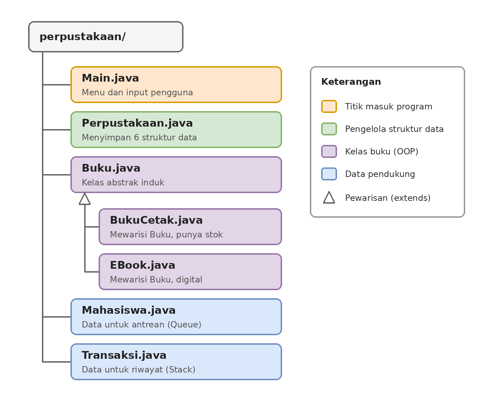

# Sistem Manajemen Perpustakaan Kampus
Sistem ini dibuat berdasarkan studi kasus untuk menunjukkan alur atau fitur dasar perpustakaan dengan menerapkan berbagai struktur data

## Tugas Pemrograman Java
- **Mata Kuliah:** Pemrograman Berorientasi Objek
- **Dosen Pengampu:** M. Ibadurrahman Arrasyid Supriyanto M.Kom.
- **Program Studi:** Sistem Informasi
- **Angkatan:** 2025
- **Kelompok:** 8 (UBAH)
  
## Anggota Kelompok 8 (UBAH)
Antonio Marc Laureno Silaban - 2509116040
Regina Jelita Ningsih - 2509116061
Dliya Syahla Hariyanto - 2509116095
Riko Azkarazendra Russianto - 2509116104

## Struktur File Proyek

